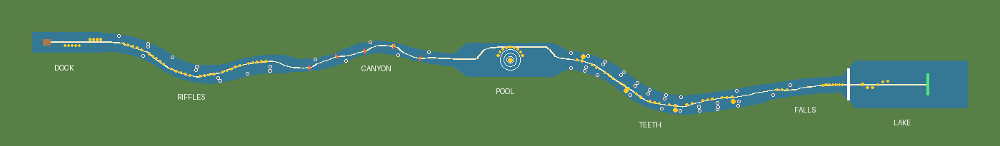

# Плот на порогах (Rapids Raft)

Кооперативный сплав для Roblox: **плотом управляют весом команды**. Встань у левого борта — плот уходит влево, у правого — вправо, на носу — быстрее, на корме — безопасно пролетаешь водопад. Один заплыв — 2,5–3 минуты, до 6 человек на плоту, до 12 на сервере.

Дизайн-документ: [`docs/DESIGN.md`](docs/DESIGN.md) · Плейтест: [`docs/PLAYTEST.md`](docs/PLAYTEST.md) · Публикация и монетизация: [`docs/PUBLISH.md`](docs/PUBLISH.md) · Локальная сессия Claude + Studio MCP: [`docs/LOCAL_SESSION.md`](docs/LOCAL_SESSION.md)



*Карта реки, сгенерирована из тех же данных, что и игра.* Белая линия — путь внимательного экипажа, серые точки — камни, жёлтые — монеты (крупные — золотые ×5), красные чёрточки — ворота-слалом, круги — омут, белая черта — водопад, зелёная — финиш.

Всё построено кодом: Terrain-река, плот, камни, деревья, интерфейс. Сторонних моделей нет.

---

## Как запустить в Roblox Studio (Windows)

### Один раз
Rokit и плагин Rojo уже стоят после «Перевала». Если нет — см. README репозитория `roblox`.
```powershell
cd "D:\programming\projects\2.IntelliJ_IDEA\Java"
git clone https://github.com/covest2051/roblox-raft.git
cd roblox-raft
git checkout claude/modest-fermi-p8gwbq
rokit install
```

### Поиграть
```powershell
git pull
rojo build -o game.rbxl
```
Открой `game.rbxl` в Studio (File → Open from File), включи **View → Output**, нажми **Play** (F5).

### Живая синхронизация кода
Открой `game.rbxl`, запусти `rojo serve` (окно не закрывать), в Studio: **Plugins → Rojo → Connect**.

### Мультиплеер в Studio
Вкладка **Test → Clients and Servers** → 2–3 игрока → **Start**. Так проверяется главное: два человека у разных бортов гасят друг друга.

## Управление
Только ходьба: WASD / стик. Куда встал — туда пошёл плот. Схема плота справа внизу показывает экипаж (точки) и центр масс (красное кольцо).

| Кнопка на экране | Что делает |
|---|---|
| ● монеты и «+» | баланс; «+» — пакеты монет и пропуска |
| Магазин | жилеты, раскраски плота, сундук с шансами, пропуска |
| Позвать друзей | приглашение Roblox |
| Сойти на берег | выйти из заплыва (монеты остаются) |
| DBG (только Studio) | автопилот, переход к участку, урон, монеты, самотест, RU/EN |

---

## Для разработки

### Структура
```
src/shared/      логика без инстансов: тестируется в Lune
  Config         все числа баланса и ID товаров
  River          геометрия реки, камни, монеты, ворота, омут, водопад
  RaftSim        модель плота: вес экипажа → руль/скорость, удары, водопад, автопилот
  Catalog        косметика, точные шансы сундука
  Profile        данные игрока: покупки, дубликаты, журнал чеков
  Rewards        множители монет
  Strings        тексты RU/EN
src/server/      мир (WorldBuilder), плот (RaftModel, RaftService), данные (DataService),
                 покупки (Monetization), жилеты (Cosmetics), запросы (Actions), SelfTest
src/client/      Hud, Shop, Fx, DebugPanel
tests/           *.spec.luau — тесты логики и баланса
tests/engine/    прогон собранного place на «заглушке» движка (сервер и клиент)
scripts/         проверка place, проверка API по дампу Roblox, карта, check.sh
```

### Проверки
```bash
./scripts/check.sh            # всё сразу: формат, линтер, тесты, сборка, прогоны на заглушке
```
С проверкой API (дамп берётся с GitHub):
```bash
curl -sSfLo API-Dump.json https://raw.githubusercontent.com/MaximumADHD/Roblox-Client-Tracker/roblox/API-Dump.json
API_DUMP=API-Dump.json ./scripts/check.sh
```
Что проверяется:
- `tests/raft.spec` — внимательный экипаж проходит реку без ударов за 2–3,5 мин; неуправляемый плот разбивается; медленный «шумный» игрок доходит;
- `tests/catalog.spec` — шансы сундука суммируются ровно в 100%, распределение бросков совпадает с показанным;
- `tests/engine/server_sim` — боты ходят по палубе и **ногами** ведут плот по всей реке, монеты начисляются, крушение и «Второй шанс», сундук и PolicyService, идемпотентность чеков, сбой DataStore;
- `tests/engine/client_sim` — весь интерфейс строится, клиент переживает все события, магазин показывает шансы, в запрещённом регионе сундука нет.

### Карта
```bash
lune run scripts/export_map.luau build/map.json
python3 scripts/render_map.py build/map.json docs/img/map.png
```

### Где менять баланс
`src/shared/Config.luau` (сила крена, урон, награды, тайминги) и `src/shared/River.luau` (участки, плотность камней). После правки — `lune run tests/run.luau`: тест баланса скажет, если река стала непроходимой или слишком лёгкой.
